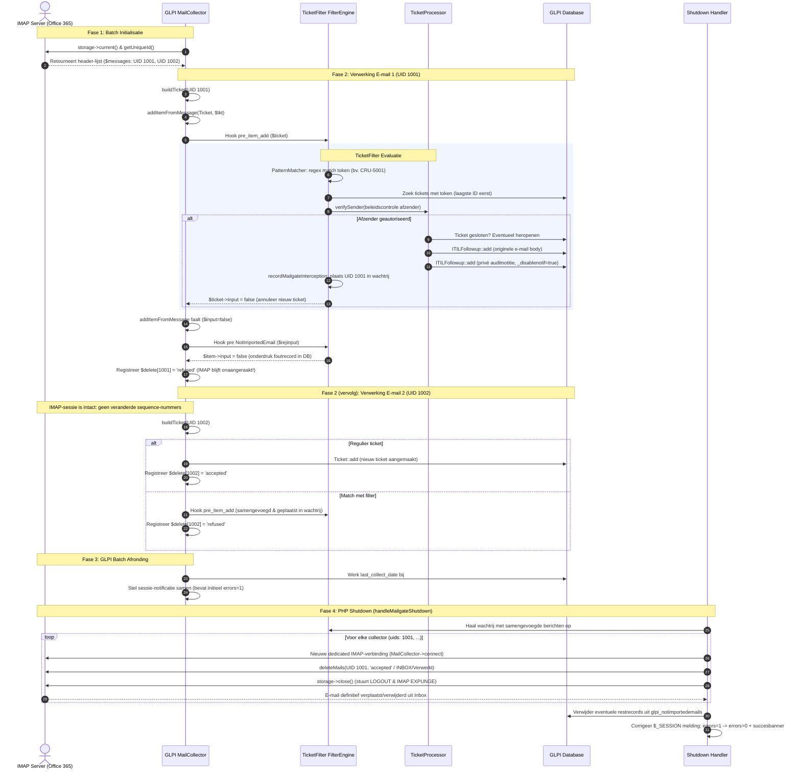

# TicketFilter Mailgate Verwerkingsflow

Dit document beschrijft de volledige flow van een binnenkomende e-mailbatch via GLPI's Mailgate (`MailCollector`) in combinatie met de TicketFilter-plugin.

---

## 1. Sequentiediagram (Levenscyclus van een Batch)

---

## 2. Stroomschema (Beslisboom per E-mail)

```mermaid
flowchart TD
    Start([Inkomende e-mail in mailbox]) --> Fetch[GLPI MailCollector haalt berichtheaders op]
    Fetch --> Build[GLPI bouwt ticket-datastructuur]
    Build --> HookPreAdd[GLPI vuurt pre_item_add hook af]
    
    HookPreAdd --> CheckFilter{Match met actief<br/>TicketFilter patroon?}
    
    CheckFilter -- Nee --> CoreGLPI[GLPI core maakt regulier ticket aan]
    CoreGLPI --> GLPIAccepted[GLPI markeert als accepted]
    
    CheckFilter -- Ja --> FindTarget[Zoek kandidaattickets met token<br/>Sorteer op laagste ID eerst]
    FindTarget --> CheckTarget{Kandidaat<br/>gevonden?}
    
    CheckTarget -- Nee --> CoreGLPI
    
    CheckTarget -- Ja --> CheckSender{Afzenderbeleid<br/>toegestaan?}
    
    CheckSender -- Nee --> PolicyAction{Onbekende afzender<br/>actie?}
    PolicyAction -- Nieuw ticket --> CoreGLPI
    PolicyAction -- Weigeren --> Refuse[Weigeren & markeren als refused]
    PolicyAction -- Privé reactie --> MergeAction
    
    CheckSender -- Ja --> MergeAction[Voer samenvoeging uit in TicketProcessor]
    
    subgraph Samenvoegen [TicketProcessor::processTicket]
        MergeAction --> CheckClosed{Is doelticket<br/>gesloten?}
        CheckClosed -- Ja & heropenen actief --> ReopenTicket[Heropen ticket & plaats heropen-notitie]
        CheckClosed -- Nee / heropenen uit --> AddFollowup
        ReopenTicket --> AddFollowup[Voeg originele e-mail toe als ITILFollowup]
        AddFollowup --> AddPrivateAudit[Voeg private auditnotitie toe<br/>is_private=1, _disablenotif=true]
    end
    
    AddPrivateAudit --> QueueMsg[Plaats e-mail in wachtrij:<br/>FilterEngine::$mergedMailgateMessages<br/>IMAP wordt NIET aangeraakt]
    QueueMsg --> CancelAdd[Zet $ticket->input = false<br/>Annuleer creatie duplicaatticket]
    
    CancelAdd --> GLPIAddFails[addItemFromMessage retourneert false]
    GLPIAddFails --> InterceptNotImported[Hook preNotImportedEmailAdd:<br/>Onderdruk foutrecord in glpi_notimportedemails]
    
    InterceptNotImported --> NextMail{Nog meer e-mails<br/>in deze batch?}
    GLPIAccepted --> NextMail
    
    NextMail -- Ja --> FetchNext[Volgende e-mail verwerken<br/>IMAP-status is 100% stabiel]
    FetchNext --> Build
    
    NextMail -- Nee --> BatchDone[GLPI collect loop beëindigd]
    
    subgraph Shutdown [handleMailgateShutdown]
        BatchDone --> GroupQueue[Groepeer wachtrij per collector<br/>Sorteer UID's aflopend]
        GroupQueue --> ConnectIMAP[Open dedicated verbinding per collector]
        ConnectIMAP --> MoveMails[Verplaats e-mails naar accepted folder]
        MoveMails --> CloseIMAP[Sluit verbinding met storage->close<br/>Office 365 commit & expungeert verplaatsing]
        CloseIMAP --> CleanDB[Verwijder eventuele NotImported records]
        CleanDB --> FixBanner[Corrigeer errors teller in sessiemelding]
    end
    
    FixBanner --> End([Einde run: mailbox schoon & tickets bijgewerkt])
```

---

## 3. Belangrijke Technische Componenten

### A. Geen IMAP-mutaties tijdens de loop
* **Probleem voorheen:** Het direct aanroepen van `deleteMails()` tijdens de `foreach ($messages)` veranderde de IMAP-index/volgnummers op de server. De volgende lazy-loaded e-mail crashte met `RuntimeException: the single id was not found in response`.
* **Oplossing:** `FilterEngine::evaluateTicket()` raakt de actieve IMAP-verbinding niet aan, maar slaat de metadata en het object op in `FilterEngine::$mergedMailgateMessages`.

### B. Shutdown Verplaatsing & IMAP Expunge
* **Probleem voorheen:** GLPI's eigen end-of-batch opschoning liet e-mails in de Inbox staan als er geen 'refused'-map was geconfigureerd, of sloot de verbinding niet geforceerd af waardoor Office 365 IMAP-flags niet permanent maakte.
* **Oplossing:** In `handleMailgateShutdown()` wordt voor elke betrokken collector één dedicated verbinding geopend, worden alle samengevoegde UID's in aflopende volgorde naar de `accepted`-map verplaatst (bv. `INBOX/Verwerkt`), en wordt `storage->close()` aangeroepen. Dit stuurt een expliciet `LOGOUT`-commando naar Office 365, wat de verplaatsing onmiddellijk expunget.

### C. Consistente Notificatiestijl
* Zowel de heropen-melding als de filter-auditnotitie worden aangemaakt als `ITILFollowup`:
  * `'is_private' => 1` (grijze gestreepte styling met oog-icoon in GLPI).
  * `'_disablenotif' => true` (geen e-mailnotificaties naar melders).
  * `'users_id' => 0` (neutrale systeemauteur).
